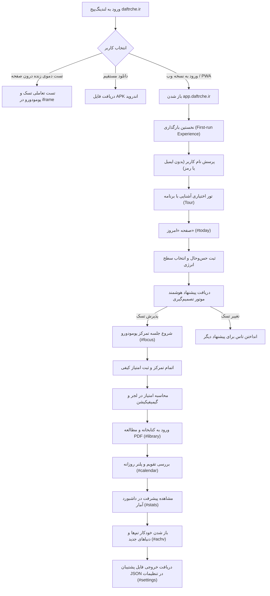
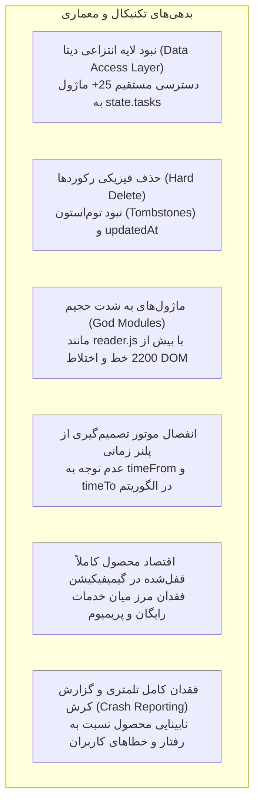

# گزارش جامع معماری نرم‌افزار و تحلیل محصول دفتَرچه (Daftarche)
**مرجع تخصصی شناخت پروژه برای معمار نرم‌افزار و مشاور محصول**  
**نسخه پروژه:** `3.5.0` (Build `v206`) | **تاریخ بررسی:** نوامبر ۲۰۲۶  
**دامنه وب‌اپلیکیشن:** `app.daftrche.ir` | **دامنه لندینگ‌پیج:** `daftrche.ir`

---

## مقدمه و دامنه بررسی (Scope of Audit)

این سند حاصل بررسی فنی، ساختاریافته و همه‌جانبه بر روی کل اکوسیستم پروژه **دفتَرچه** شامل:
1. **وب‌اپلیکیشن PWA و کلاینت اندروید** (مستقر در پوشه `NewDaftrche` روی ساب‌دامین `app.daftrche.ir`)
2. **سایت لندینگ و بازاریابی** (مستقر در `daftarche-landing` روی دامنه اصلی `daftrche.ir`)
3. **سرور اختیاری اعلان‌ها (Web Push Server)** (مستقر در پوشه `server/`)
4. **پیکربندی‌های استقرار، سرور، تست‌ها و اسناد بالادستی**

کلیه ادعاها و یافته‌های این گزارش با ارجاع دقیق به فایل‌ها، ماژول‌ها و خطوط کد در مخزن مستند شده‌اند.

---

## ۱. معرفی کلی و ارزش پیشنهادی محصول (Product Overview)

### ۱.۱. هدف اصلی پروژه و مسائل حل‌شده
* **فلسفه بنیادین:** «امروز قرار نیست همه‌چیز را انجام بدهی.» پروژه دفتَرچه با هدف ایجاد یک فضای کاری **آرام (Calm Productivity)، محلی (Local-First)، خصوصی (Privacy-First) و بدون حواس‌پرتی (Distraction-Free)** طراحی شده است.
* **مسئله اصلی (Problem Statement):**
  * در اکثر نرم‌افزارهای مدیریت وظایف (To-Do Apps) مانند Todoist، Notion یا Trello، کاربر با فهرست‌های بی‌پایانی از کارها محاصره می‌شود که منجر به سردرگمی شناختی و فلج تصمیم‌گیری (**Task Paralysis / Overwhelm**) می‌گردد.
  * برنامه‌های معمول صرفاً می‌پرسند: *«چه کارهایی داری؟»* اما هیچ پاسخی برای این سوال حیاتی ندارند: *«الان با توجه به انرژی و شرایطم کدام کار را انجام دهم؟»*.
  * وابستگی شدید ابزارهای مدرن به اینترنت، احراز هویت‌های اجباری و ارسال داده‌ها به سرورهای ابری، حریم خصوصی کاربر را مخدوش کرده و سرعت استفاده در شرایط آفلاین یا اختلال شبکه (مشکل همیشگی کاربران ایرانی) را کاهش می‌دهد.
* **راهکار دفتَرچه (Value Proposition):**
  * **شروع بدون اصطکاک (Zero-Friction / Guest-First):** بدون فرم ثبت‌نام یا لاگین؛ برنامه فوراً در مرورگر بالا آمده و تمام داده‌ها درون دستگاه کاربر ذخیره می‌شود.
  * **موتور تصمیم‌گیری هوشمند (Decision Engine):** به جای نمایش انبوهی از تسک‌ها، سیستم با ارزیابی سطح انرژی کنونی کاربر (کم، متوسط، زیاد)، مهلت‌ها و اولویت‌ها، **یک کار پیشنهادی مشخص** را همراه با دلیل شفاف انسانی در صفحه «امروز» به کاربر توصیه می‌کند.
  * **ترکیب ابزارهای مکمل:** یکپارچگی مدیریت کارها با تایمر تمرکز پومودورو، کتابخانه و کتاب‌خوان محلی PDF، تقویم هجری شمسی و گیمیفیکیشن سالم مبتنی بر استمرار (Streak).
* **مخاطبان هدف (Target Audience):**
  * دانشجویان و دانش‌آموزان ایرانی برای مدیریت مطالعه و برنامه‌ریزی درسی.
  * فریلنسرها، برنامه‌نویسان و نویسندگانی که نیازمند محیطی فارسی، راست‌چین و عاری از حواس‌پرتی و نوتیفیکیشن‌های زرد هستند.
  * کاربرانی که به حریم خصوصی حساس هستند و تمایلی به آپلود یادداشت‌ها و کتاب‌های خود روی سرورهای خارجی ندارند.

---

### ۱.۲. ویژگی‌ها و قابلیت‌های کلیدی (Features)

| حوزه | قابلیت‌های پیاده‌سازی شده در کد | فایل‌ها و شواهد پیاده‌سازی |
|---|---|---|
| **مدیریت وظایف (Tasks)** | ایجاد، ویرایش، حذف، برچسب‌ها/دسته‌بندی، اولویت‌ها (فوری/مهم/معمولی)، تعیین مهلت شمسی، تخمین مدت زمان (دقیقه)، بازه زمانی مشخص (`timeFrom`/`timeTo`)، فیلترها، جستجو، مرتب‌سازی دستی و معکوس. | `js/tasks.js`, `js/taskedit.js`, `js/state.js` |
| **افزودن سریع با زبان طبیعی (NLP QuickAdd)** | تجزیه رشته ورودی فارسی برای استخراج خودکار تاریخ، زمان، هشتگ دسته‌بندی و مدت زمان تخمینی. | `js/quickadd.js`, `tests/quickadd.test.mjs` |
| **صفحه امروز و موتور تصمیم‌گیری** | فیلتر کارهای سررسید امروز، ثبت حس‌وحال (Mood)، انتخاب سطح انرژی و پیشنهاد هوشمند بهترین کار بعدی با الگوریتم امتیازدهی وزنی و دکمه تاس (انتخاب تصادفی جایگزین). | `js/today.js`, `js/decision.js`, `js/decisioncontext.js` |
| **تمرکز و پومودورو (Focus)** | تایمر معکوس پومودورو، دوره‌های استراحت، حفظ وضعیت جلسه باز در حافظه محلی، تولید و پخش صداهای سنتز شده/امبینت، بارگذاری فایل صوتی شخصی، ثبت ارزیابی کیفی جلسه. | `js/focus.js`, `js/focushistory.js`, `js/audio.js` |
| **کتابخانه و PDFخوان آفلاین** | آپلود فایل‌های کتاب در حافظه مرورگر (`IndexedDB`)، خواندن محلی بدون اینترنت با PDF.js محلی، پیگیری صفحات خوانده‌شده، اهداف روزانه، یادداشت‌برداری، هایلایت متنی و رسم آزاد با قلم. | `js/library.js`, `js/reader.js`, `assets/vendor/pdfjs/` |
| **تقویم جلالی و برنامه‌ریز (Planner)** | تقویم کامل هجری شمسی، شروع هفته از شنبه، مناسبت‌های رسمی، نمای شبکه‌ای ماه، برنامه‌ریز روزانه بر اساس ساعت، نمای هفته. | `js/calendar.js`, `js/planner.js`, `js/jalali.js`, `js/week.js` |
| **گیمیفیکیشن و دستاوردها** | سیستم سطوح (Rank)، امتیازدهی، قفسه نشان‌ها (Badges)، محاسبه زنجیره استمرار روزانه (Streak) با قابلیت انجماد (Freeze) بدون سوختن پیشرفت. | `js/achievements.js`, `js/achievementsview.js`, `js/ledger.js` |
| **تم‌ها و دنیاها (Themes & Worlds)** | ۱۸ پالت رنگی استاندارد (روشن/تاریک)، ۱۰ تم گرافیکی تعاملی دنیا (قله دماوند، کهکشان، مینیاتور، ققنوس، اکسیر، روز تولد و...) با کاراکترهای همراه (قورقوری، خوابالو و...). | `js/theme.js`, `js/worlds.js`, `js/constants.js`, `css/worlds.css` |
| **آمار و کارت اشتراک‌گذاری** | نمودارهای بازدهی، رادار تعادل هفتگی، خلاصه آماری، تولید تصویر کارت افتخار با Canvas برای اشتراک در شبکه‌های اجتماعی. | `js/stats.js`, `js/insights.js`, `js/sharecard.js` |
| **پشتیبان‌گیری و ایمنی داده** | خروجی/ورودی فایل JSON کامل از تنظیمات و تسک‌ها، بسته کتاب‌ها (PDF Pack)، سازوکار اتمیک بازگردانی با Rollback و ادغام هوشمند دو نسخه (Merge Engine). | `js/backup.js`, `js/backup-nudge.js`, `js/pdfpack.js` |
| **شل PWA و نسخه نیتیو** | نصب مستقیم از مرورگر با کش آفلاین کامل Service Worker، خروجی نیتیو اندروید با نوتیفیکیشن محلی. | `sw.js`, `manifest.webmanifest`, `js/native.js`, `android/` |

---

### ۱.۳. وضعیت فعلی توسعه (Current Maturity Status)

* **بخش‌های کامل و عملیاتی (Verified & Complete):**
  * کل هسته کلاینت تک‌کاربره لوکال: تسک‌ها، ریدر PDF، پومودورو، تقویم، تم‌ها، سیستم ذخیره‌سازی محلی و پشتیبان‌گیری.
  * مجموعه تست‌های منطق با **۴۴۲ تست پاس‌شده (۰ شکست)** در زمان ~۲.۴ ثانیه با رانر `node --test`.
  * لندینگ‌پیج با ویجت‌های تعاملی، دموی زنده PWA درون آی‌فریم و سئوی محتوایی کامل.
* **بخش‌های ناقص یا در حد مدل‌سازی اولیه (Partial):**
  * **سرور پوش (Web Push):** بک‌اند Express در `server/push-server.js` کامل و تست شده است، اما در کلاینت در `js/push-service.js:18` با متغیر `WEB_PUSH_ENABLED = false` خاموش نگه داشته شده است.
  * **عملیات دانشگاهی (Academic Workflow):** برچسب‌های عمومی وجود دارد، اما ساختارهای تحصیلی (ترم، درس، جدول کلاسی، نمرات و امتحانات) غایب هستند.
  * **اتصال بازه زمانی به موتور تصمیم‌گیری:** فیلدهای `timeFrom` و `timeTo` در مدل تسک ثبت می‌شوند اما موتور تصمیم‌گیری (`decision.js`) آن را در اولویت‌بندی لحاظ نمی‌کند.
* **بخش‌های غایب، کامنت‌شده یا Mock (Missing / TODO):**
  * **احراز هویت و حساب کاربری (Auth & Accounts):** هیچ سیستم ورود/ثبت‌نام، توکن یا شناسایی کاربر سمت سرور وجود ندارد.
  * **همگام‌سازی ابری (Cloud Sync):** هیچ سازوکار همگام‌سازی شبکه بین چند دستگاه وجود ندارد. ارجاعات به Supabase در `js/store.js` و `js/achievements.js` صرفاً در حد کامنت‌های برنامه‌ریزی آینده است.
  * **درگاه پرداخت و سیستم لایسنس (Monetization):** هیچ کدی برای اتصال به زرین‌پال، شتاب یا کافه‌بازار وجود ندارد. قفل‌گشایی تم‌ها صرفاً از طریق گیمیفیکیشن درون‌برنامه‌ای است.

---

## ۲. پشته فناوری و معماری (Tech Stack & Architecture)

### ۲.۱. فرانت‌اند (Frontend)
* **معماری بدون فریم‌ورک (Zero-Framework / Vanilla Web):**
  پروژه هیچ وابستگی به React، Vue، Angular یا Svelte ندارد. کل فرانت‌اند با **Pure JavaScript (ES2022+)** بر پایه ماژول‌های استاندارد مرورگر (`type="module"`) ساخته شده است.
* **مدیریت وضعیت (State Management):**
  * یک سینگلتون درون‌حافظه‌ای در `js/state.js` به عنوان منبع وضعیت فعال برنامه عمل می‌کند.
  * یک باس رویداد سفارشی و سبک Publish/Subscribe در `js/bus.js` برای تبادل رویدادها بین ماژول‌های مختلف استفاده می‌شود.
  * کش حافظه‌ای مشتق‌شده برای شاخص‌های تاریخ در `js/daycache.js`.
* **لایه‌بندی استایل‌ها (CSS Architecture):**
  * بدون Tailwind یا فریم‌ورک‌های کامپوننتی خارجی؛ ۲۴ فایل CSS دست‌نویس با تفکیک وظایف دقیق.
  * سیستم طراحی توکن‌محور در `css/base.css` با استفاده از CSS Custom Properties (`--color-*`, `--pal-*`, `--space-*`, `--radius-*`).
  * پایبندی سخت‌گیرانه به ویژگی‌های منطقی مدرن (`margin-inline-start`, `padding-inline-end`, `inset-inline-*`) جهت تضمین رفتار بی‌نقص در چیدمان راست‌چین (RTL).
  * پشتیبانی ذاتی از حالت‌های تاریک/روشن (`color-scheme`) و تنظیمات کاهش حرکت سیستم‌عامل (`prefers-reduced-motion`).
* **ابزارهای ساخت و بیلد (Build Tools):**
  * برای وب: **بدون مرحله بیلد (No-Build Pipeline)**؛ فایل‌ها بدون باندلر (No Vite/Webpack/Rollup) مستقیماً اجرا می‌شوند.
  * برای اندروید: استفاده از **Capacitor 8.5** به همراه اسکریپت سفارشی `tools/build-www.mjs` جهت سنکرون‌سازی و کپی دارایی‌ها در پوشه `www/`.

---

### ۲.۲. بک‌اند و دیتابیس (Backend & Database)
* **معماری بک‌اند (Backend Architecture):**
  * وب‌اپلیکیشن به صورت کاملاً مستقل و کلاینت‌محور بدون نیاز به بک‌اند برای کارهای اصلی اجرا می‌شود.
  * یک میکروسرویس اختیاری Node.js بر پایه **Express 4.19** در `server/push-server.js` تعبیه شده که وظیفه نگهداری اشتراک‌های مرورگر و ارسال پوش نوتیفیکیشن‌های VAPID را از طریق کتابخانه `web-push` بر عهده دارد.
* **دیتابیس و ذخیره‌سازی داده‌ها (Data Layer):**
  * **سمت کلاینت (Client-side):**
    * `localStorage`: نگهداری متادیتا، تنظیمات، لیست تسک‌ها و تاریخچه (مدیریت شده از درگاه واحد `js/store.js` با ذخیره دیبانس‌شده ۵۰۰ میلی‌ثانیه‌ای و فلاش خودکار در `pagehide`/`beforeunload`).
    * `IndexedDB`: نگهداری داده‌های سنگین باینری شامل فایل‌های PDF کتاب‌ها در دیتابیس `daftarche-books` (فروشگاه `books`) و ترک‌های صوتی آپلود شده در `daftarche-audio`.
  * **سمت سرور (Server-side):**
    * ذخیره‌سازی بر پایه فایل اتمیک در دیسک: `server/subscriptions.json` با مکانیزم صف پرامیس‌ها (Promise Chain) و تکنیک Atomic Write (نوشتن در فایل موقت `.tmp` و جایگزینی اتمیک با `rename`). در زمان بوت در صورت خرابی فایل، آن را قرنطینه (`*.corrupt-*`) کرده و دیتابیس پاک بالا می‌آید.
* **احراز هویت و APIها (Auth & APIs):**
  * در کلاینت هیچ نوع احراز هویتی وجود ندارد.
  * در سرور پوش، اندپوینت‌های عملیاتی تحت متدولوژی RESTful با هدر `Authorization: Bearer <ADMIN_API_KEY>` محافظت می‌شوند. مقایسه کلید با متد ضد حمله زمان‌بندی `crypto.timingSafeEqual` انجام می‌گیرد.

---

### ۲.۳. سرویس‌های جانبی (Third-party Integrations)
* **درگاه پرداخت (Payment Gateway):** صفر (هیچ درگاه ریالی یا ارزی متصل نیست).
* **سرویس پیامک/ایمیل:** صفر (تنها آدرس ایمیل در پیکربندی VAPID سرور به صورت `mailto:` ارسال می‌شود).
* **ذخیره‌سازی ابری (Cloud Storage):** صفر (فایل‌ها در حافظه محلی مرورگر باقی می‌مانند).
* **آنالیتیکس و ترکرها:** **کاملاً صفر.** هیچ اسکریپت رهگیری (Google Analytics, Yandex, Clarity, Sentry) در کدها وجود ندارد که یک نقطه قوت بزرگ از دید حفظ حریم خصوصی است.
* **کتابخانه‌های فرانت‌اند خارجی:**
  * موتور **PDF.js v4.10** که پیش‌تر از شبکه jsDelivr لود می‌شد، هم‌اکنون به صورت محلی در مسیر `assets/vendor/pdfjs/` قرار داده شده و پروژه را کاملاً خودکفا کرده است.

---

### ۲.۴. ساختار پوشه‌ها و تفکیک لندینگ از وباپ (Folder Structure)

پروژه به صورت دو موجودیت مستقل اما هماهنگ پیکربندی شده است:
1. مخزن برنامه اصلی (`NewDaftrche/`) که روی ساب‌دامین `app.daftrche.ir` قرار می‌گیرد.
2. مخزن لندینگ‌پیج (`daftarche-landing/`) که روی دامنه اصلی `daftrche.ir` قرار دارد.

```text
d:\Project\
├── NewDaftrche\                      # [مخزن اصلی وباپ و اپلیکیشن PWA]
│   ├── index.html                    # سند اصلی وب‌اپلیکیشن (شامل کدهای تمام ۹ صفحه)
│   ├── sw.js                         # سرویس ورکر PWA و مدیریت کش آفلاین
│   ├── manifest.webmanifest          # مانیفست استاندارد وب‌اپلیکیشن
│   ├── _headers                      # پیکربندی هدرهای امنیتی و کش (Cloudflare Pages)
│   ├── CNAME                         # اشاره به ساب‌دامین app.daftrche.ir
│   ├── capacitor.config.json         # تنظیمات بسته‌بندی اندروید Capacitor
│   ├── package.json                  # تعریف اسکریپت‌های تست، ابزارها و وابستگی‌های موبایل
│   ├── AGENTS.md                     # قوانین اجباری توسعه پروژه (کدگذاری، نسخه و استایل)
│   ├── js/                           # ماژول‌های جاوااسکریپت برنامه (۶۸ ماژول، ~۲۸ هزار خط)
│   │   ├── app.js                    # نقطه ورود اجرای ماژول‌ها و راه‌اندازی ناوبری
│   │   ├── state.js                  # شیء سینگلتون مدیریت وضعیت
│   │   ├── store.js                  # درگاه مرکزی ارتباط با localStorage و مایگریشن
│   │   ├── decision.js               # موتور رتبه‌بندی و اولویت‌بندی تسک‌ها
│   │   ├── tasks.js / taskedit.js    # مدیریت و رندرینگ تسک‌ها
│   │   ├── focus.js / audio.js       # پومودورو و سنتز صدا
│   │   ├── library.js / reader.js    # کتابخانه و نمایشگر PDF
│   │   ├── calendar.js / planner.js  # تقویم شمسی جلالی و برنامه‌ریز روز
│   │   ├── backup.js                 # موتور خروجی، بازیابی و Merge داده‌ها
│   │   ├── theme.js / worlds.js      # تم‌های گرافیکی و دنیاهای تعاملی
│   │   └── ...
│   ├── css/                          # استایل‌های ماژولار CSS (۲۴ فایل)
│   │   ├── base.css                  # سیستم توکن‌های طراحی، رنگ‌ها و تعاریف پایه
│   │   ├── components.css            # استایل مؤلفه‌های مشترک
│   │   ├── worlds.css                # انیمیشن‌ها و پس‌زمینه‌های دنیاها
│   │   └── ...
│   ├── assets/                       # دارایی‌های استاتیک
│   │   ├── fonts/                    # فونت‌های محلی بهینه‌شده فارسی (Vazirmatn)
│   │   ├── icons/                    # آیکون‌های SVG برنامه و PWA
│   │   ├── characters/               # گرافیک برداری کاراکترها (قورقوری و...)
│   │   └── vendor/pdfjs/             # ران‌تایم محلی کتاب‌خوان PDF.js
│   ├── server/                       # بک‌اند اختیاری Web Push
│   │   ├── push-server.js            # وب‌سرور Express برای مدیریت اشتراک‌ها و ارسال اعلان
│   │   ├── package.json              # وابستگی‌های سرور (express, web-push)
│   │   └── subscriptions.json        # فایل پایگاه‌داده محلی اشتراک‌ها
│   ├── android/                      # پروژه تولیدی نیتیو اندروید (Gradle / Java)
│   ├── www/                          # دارایی‌های ساخته‌شده وب برای تزریق به اندروید
│   ├── tests/                        # آزمون‌های خودکار Node.js (۴۱ فایل تست، ۴۴۲ آزمون)
│   ├── tools/ & scripts/             # ابزارهای خودکارسازی، تولید آیکون، اسکرین‌شات و بیلد APK
│   └── docs/                         # مستندات فنی و گزارش‌های ممیزی معماری
│
└── دفترچه\daftarche-landing\          # [سایت لندینگ و بازاریابی]
    ├── index.html                    # لندینگ تک‌صفحه‌ای با بخش‌های معرفی و دموی آی‌فریم
    ├── 404.html                      # صفحه خطای اختصاصی استاتیک
    ├── CNAME                         # تنظیم دامنه اصلی daftrche.ir
    ├── nginx.conf                    # کانفیگ Nginx برای هاست تمیز و ریدایرکت‌ها
    ├── vercel.json                   # تنظیمات استقرار در پلتفرم Vercel
    ├── _headers & _redirects         # تنظیمات ریدایرکت و هدرها برای Cloudflare Pages / Netlify
    ├── js/landing.js                 # منطق تعاملی لندینگ، ویجت‌ها و گارد ضد فریم (Anti-framing)
    ├── css/landing.css               # استایل‌های بهینه‌شده و ریسپانسیو لندینگ
    └── downloads/                    # فایل خروجی APK برای دانلود مستقیم کاربران
```

* **نحوه اتصال لندینگ و وباپ:**
  * اتصال از طریق معماری Subdomain انجام شده است: دامنه والد `daftrche.ir` ویترین محصول و ساب‌دامین `app.daftrche.ir` محصول نرم‌افزاری است.
  * در بخش Hero لندینگ، وباپ از طریق یک عنصر `<iframe>` امن با آدرس `https://app.daftrche.ir/` لود می‌شود تا کاربر بتواند بدون ورود رسمی، برنامه را لمس کند. امنیت این پیوند با سیاست سخت‌گیرانه CSP (`frame-src https://app.daftrche.ir` در لندینگ و `frame-ancestors 'self' https://daftrche.ir` یا گارد JS) کنترل می‌گردد.

---

## ۳. جریان کاربری و صفحات (User Flow & Pages/Routes)

### ۳.۱. فهرست کامل مسیرها (Routes)

#### الف) مسیرهای سایت لندینگ (`daftrche.ir`)
سایت لندینگ دارای مسیریابی بر مبنای Clean URLs و بخش‌های تک‌صفحه‌ای (Anchor Navigation) است:
* `/` (یا ریدایرکت از `/index.html`) : صفحه اصلی لندینگ
* `/downloads/daftarche.apk` (با ریدایرکت ۳۰۱ از نام قدیمی `/downloads/app-release.apk`) : دانلود مستقیم نصاب اندروید
* `/#contribute` (با ریدایرکت ۳۰۱ از `/contribute` و `/contribute.html`) : بخش راهنمای مشارکت در گیت‌هاب
* `/404.html` : صفحه اختصاصی ۴۰۴
* **انکرها (بخش‌های داخلی):**
  * `#hero` : عنوان اصلی و پیش‌نمایش دموی زنده
  * `#why` : چرایی انتخاب دفترچه و تمایز آن با تسک‌منیجرهای سنتی
  * `#features` : معرفی امکانات کلیدی (ویجت «الان چه کنم؟»، پومودورو، ریدر)
  * `#characters` : معرفی کاراکترهای همراه با دیالوگ‌های متغیر
  * `#download` : گزینه‌های دانلود (PWA، اندروید، QR Code)
  * `#install` : راهنمای گام‌به‌گام نصب در iOS و Android
  * `#faq` : سوالات پرتکرار (امنیت، آفلاین بودن، رایگان بودن)
  * `#contribute` : مخزن کد و نحوه مشارکت برنامه‌نویسان
  * `#start` : دکمه نهایی فراخوان عمل (CTA)
  * `#privacy` و `#about` : پانویس، سیاست حفظ حریم خصوصی و درباره ما

#### ب) مسیرهای وب‌اپلیکیشن (`app.daftrche.ir`)
وباپ یک اپلیکیشن تک‌صفحه‌ای (Single Page Application) است که از تاریخچه مرورگر و URL Hash برای ناوبری استفاده می‌کند. ۹ صفحه اصلی در یک سند HTML قرار دارند که به صورت پویا (Progressive Hydration) آماده می‌شوند:

* **تب‌های اصلی نوار پایین (Primary Pages):**
  * `/#today` : صفحه امروز (پیشنهاد هوشمند تسک، کارهای روزانه، وضعیت حس‌وحال)
  * `/#tasks` : صفحه فهرست کامل کارها، فیلتر دسته‌ها و برچسب‌ها
  * `/#focus` : صفحه تمرکز و تایمر پومودورو
  * `/#library` : صفحه کتابخانه و کتاب‌های در حال مطالعه
* **صفحات فرعی در شیت «بیشتر» (More Pages):**
  * `/#calendar` : تقویم ماهانه و برنامه‌ریز روزانه (همچنین نام مستعار `/#week` به این مسیر هدایت می‌شود)
  * `/#stats` : داشبورد آماری، گزارش‌های هفتگی و رادار فعالیت
  * `/#achv` : تالار افتخارات، مدال‌ها، سطح کاربر و شرایط باز شدن دنیاها
  * `/#profile` : پروفایل کاربر، تعیین نام نمایشی و انتخاب کاراکتر
  * `/#settings` : تنظیمات برنامه، انتخاب تم‌ها، پشتیبان‌گیری داده‌ها و نسخه برنامه
* **لایه‌ها و پنجره‌های روآیند (Overlays & Modals):**
  * `#readerView` : نمای تمام‌صفحه پیشرفته مطالعه کتاب PDF و یادداشت‌برداری
  * `#taskEditModal` : مودال ویرایش جزئیات کار (مهلت، یادآور، زمان)
  * `#moreSheet` : شیت بازشونده از پایین برای دسترسی به صفحات فرعی
  * `#shareCardModal` : پنجره خروجی گرافیکی دستاوردها جهت اشتراک‌گذاری

---

### ۳.۲. شرح گام‌به‌گام مسیر کاربر (End-to-End User Journey)



1. **کشف محصول در لندینگ:** کاربر وارد `daftrche.ir` می‌شود. پیام اصلی آرامش و عدم اضطراب را می‌بیند. بدون نصب، چند تسک تستی درون پیش‌نمایش آی‌فریم وارد می‌کند یا روی «ورود به دفتَرچه» کلیک می‌کند.
2. **ورود با اصطکاک صفر (Zero Friction):** هیچ سدی به نام ثبت‌نام با شماره همراه، رمز عبور یا کد تأیید وجود ندارد. برنامه فوراً در مرورگر لود می‌شود. برای بار اول، تنها نام کوچک کاربر برای شخصی‌سازی ادبیات جملات پرسیده شده و در صورت تمایل، یک تور تصویری ۴ مرحله‌ای برای معرفی صفحات اجرا می‌شود.
3. **سازماندهی اولیه کارها:** کاربر تسک‌های خود را از طریق ورودی سریع با زبان محاوره‌ای (مثلاً «خواندن فصل ۲ فیزیک فردا ۲ ساعت #درس») اضافه می‌کند.
4. **شروع روز با تصمیم‌گیری:** در ابتدای روز کاربر وارد صفحه «امروز» می‌شود، حس‌وحال خود را انتخاب کرده و دکمه سطح انرژی (کم/معمولی/زیاد) را لمس می‌کند. موتور تصمیم‌گیری بلافاصله کار پیشنهادی را با دلیل (مثلاً «چون مهلتش گذشته و مدت زمان کوتاهی می‌خواهد») روی کارت اصلی قرار می‌دهد.
5. **اجرای کار در مود تمرکز:** با زدن دکمه شروع، کاربر به صفحه پومودورو منتقل شده، صدای ملایم باران یا سنتز امبینت را روشن کرده و ۲۵ دقیقه متمرکز می‌شود. در پایان، میزان رضایت را ثبت می‌کند.
6. **مطالعه و استراحت:** کاربر کتاب PDF خود را باز کرده، مطالعه می‌کند و برنامه تعداد صفحات خوانده‌شده را ثبت می‌نماید.
7. **پاداش و استمرار:** در پایان هفته، زنجیره روزانه (Streak) کاربر افزایش یافته، رتبه وی ارتقا پیدا می‌کند و تم‌های دنیاها (مانند تم مینیاتور یا قله دماوند) قفل‌گشایی می‌شوند. در نهایت، کاربر یک فایل پشتیبان JSON از تنظیمات و داده‌هایش در کامپیوتر یا گوشی خود ذخیره می‌کند.

---

## ۴. وضعیت سرور، تنظیمات و امنیت (Deployment, Config & Security)

### ۴.۱. فایل‌های تنظیمات استقرار و میزبانی

| سرویس / سرور | فایل پیکربندی | نقش و نحوه عملکرد |
|---|---|---|
| **Cloudflare Pages / CDN** | `_headers` (در هر دو پروژه) | تعیین هدرهای امنیتی سخت‌گیرانه (CSP، HSTS، X-Frame-Options)، تنظیم کش طولانی‌مدت (۱ سال) برای فونت‌ها و اسکریپت‌های تغییرناپذیر، و منع کش برای `index.html` و `sw.js`. |
| **Cloudflare Pages / Netlify** | `_redirects` (در لندینگ) | مدیریت ریدایرکت‌های ۳۰۱ دائم برای فایل APK، هدایت مسیرهای قدیمی مشارکت به انکر `/#contribute` و نگاشت Clean URLs برای صفحات `.html`. |
| **Nginx Web Server** | `nginx.conf` (در لندینگ) | پیکربندی سرور لینوکسی با ریدایرکت خودکار فایل‌های html به آدرس تمیز (`try_files $uri $uri.html $uri/ =404`) و مسدودسازی دسترسی به فایل‌های موقت و بکاپ (`.bak`, `.tmp`). |
| **Vercel Platform** | `vercel.json` (در لندینگ) | فعال‌سازی `cleanUrls: true` و اعمال قوانین بازنویسی آدرس‌ها. |
| **Apache & IIS** | `.htaccess` و `web.config` | قوانین بازنویسی معادل برای وب‌سرورهای سنتی. |
| **تنظیم دامنه و ساب‌دامین** | `CNAME` | در لندینگ با مقدار `daftrche.ir` و در اپلیکیشن با مقدار `app.daftrche.ir`. ارتباط از طریق رکوردهای DNS ارائه‌دهنده دامنه مدیریت می‌شود. |
| **سیستم کلاینت اندروید** | `capacitor.config.json` | تعیین `appId: ir.daftrche.app`، نام بسته، دایرکتوری وب `www` و تنظیمات سازگاری با سیستم‌عامل اندروید. |

---

### ۴.۲. متغیرهای محیطی مورد نیاز (Environment Variables)

> [!IMPORTANT]
> با توجه به معماری ایستا (Static Client) وب‌اپلیکیشن و لندینگ‌پیج، فرانت‌اند به هیچ متغیر محیطی در زمان اجرا نیاز ندارد. کلیه متغیرها مربوط به سرور پوش (`server/push-server.js`) هستند:

* `PORT` : پورت اجرای سرور وب‌سوکت/اکسپرس (پیش‌فرض: ۳۱۰۰)
* `NODE_ENV` : محیط اجرا (`production` یا `development`)
* `ALLOWED_ORIGIN` : مبدأهای مجاز CORS در پروداکشن (مثلاً `https://app.daftrche.ir`)
* `VAPID_PUBLIC_KEY` : کلید عمومی VAPID برای کلاینت‌ها (تولید با `npm run keys`)
* `VAPID_PRIVATE_KEY` : کلید خصوصی محرمانه VAPID برای رمزنگاری پیام‌های پوش
* `ADMIN_API_KEY` : توکن رمزی مدیر برای فراخوانی اندپوینت‌های کران‌جاب و تست (حداقل ۱۶ کاراکتر)
* `VAPID_CONTACT` : آدرس ایمیل ارائه‌دهنده سرویس به عنوان هویت در استاندارد VAPID
* `ENABLE_TEST_PUSH` : فلگ فعال‌سازی اندپوینت آزمایشی تست در محیط پروداکشن (`true`/`false`)
* `TASKS_URL` : آدرس اختیاری برای دریافت لیست تسک‌ها از یک API خارجی توسط کران‌جاب

---

### ۴.۳. ارزیابی امنیتی (Security Audit)

* **حفظ حریم خصوصی ذاتی (Privacy by Design):**
  * هیچ داده‌ای از تسک‌ها، کتاب‌ها، زمان‌های تمرکز یا یادداشت‌ها به هیچ سروری ارسال نمی‌شود. داده‌ها کاملاً در قلمرو مرورگر کاربر باقی می‌مانند.
* **سیاست امنیت محتوا (CSP - Content Security Policy):**
  * هدر CSP بسیار دقیق در `_headers` تعریف شده است: `default-src 'self'`، مسدودسازی اشیاء و پلاگین‌ها (`object-src 'none'`)، جلوگیری از فرم‌های خارجی (`form-action 'none'`).
  * اسکریپت اینلاین بوت اولیه در `index.html` با هش SHA-256 رمزنگاری شده مجاز دانسته شده و از `unsafe-inline` برای اسکریپت‌ها ممانعت شده است.
* **محافظت در برابر فیشینگ و کلیک‌جکینگ (Anti-Clickjacking):**
  * در وب‌اپلیکیشن هدر `X-Frame-Options: SAMEORIGIN` اعمال شده است.
  * در لندینگ‌پیج به دلیل محدودیت‌های گیت‌هاب پیجز در ارسال هدرهای سفارشی، یک **گارد ضد فریم جاوااسکریپتی** در `js/landing.js` پیاده شده که در صورت بارگذاری سایت درون آی‌فریم توسط یک دامنه غریبه، کل سند را با یک هشدار جایگزین می‌کند.
* **پیشگیری از حملات تزریق کد (XSS Prevention):**
  * طبق قواعد استاندارد پروژه (`AGENTS.md`)، هیچ داده ورودی کاربر اجازه ورود به `innerHTML` را بدون فیلتر شدن از تابع `esc()` ندارد و در اکثر بخش‌ها از `textContent` استفاده شده است.
* **امنیت سرور پوش (Push Server Hardening):**
  * محدودیت نرخ درخواست (Rate Limiting) درون‌حافظه‌ای بر اساس IP برای جلوگیری از حملات Brute-Force یا اسپم.
  * محدودسازی اندازه بدنه درخواست‌ها به سقف ۱۶ کیلوبایت (`limit: '16kb'`) جهت پیشگیری از DoS.
  * احراز هویت درخواست‌های ادمین با متد زمان‌ثابت `crypto.timingSafeEqual` برای بی‌اثر کردن حملات کانال جانبی زمان (Timing Attack).
  * محرمانگی لاگ‌ها: آدرس‌های اشتراک قبل از ثبت در لاگ به هش SHA-256 ده کاراکتری تبدیل می‌شوند و کلیدهای رمزگذاری هرگز لاگ نمی‌شوند.

---

## ۵. نقاط قوت، ضعف فنی و بدهی‌های تکنیکال (Technical Audit)

### ۵.۱. نقاط قوت معماری و کدنویسی (Architectural Strengths)

1. **عملکرد خیره‌کننده و عدم وابستگی اجرایی (Zero-Dependency Architecture):**
   حذف فریم‌ورک‌ها و باندلرها باعث شده برنامه حجم فوق‌العاده پایینی داشته باشد، در کسری از ثانیه در ضعیف‌ترین دستگاه‌ها اجرا شود و درگیر شکست نسخه‌ها (Dependency Drift) نگردد.
2. **پایداری استثنایی و انضباط در تست‌نویسی:**
   وجود **۴۴۲ تست خودکار سبز** با سرعت اجرای باورنکردنی (~۲.۴ ثانیه) نشان از تفکر عمیق مهندسی بر روی مدل‌های منطقی (تقویم، بکاپ، گیمیفیکیشن، تصمیم‌گیری و NLP) دارد.
3. **موتور ادغام بکاپ پیشرفته (Sophisticated Merge Engine):**
   ماژول `js/backup.js` حاوی منطق دامنه‌محور دقیق برای ادغام داده‌های دو دستگاه است (تسک انجام‌شده حقیقت قطعی است، صفحات کتاب فقط افزایش می‌یابد، مدال‌ها هرگز تنزل نمی‌کنند). این دارایی باارزش، بستر آماده‌ای برای هرگونه سنکرون‌سازی آینده است.
4. **تاب‌آوری در برابر از دست رفتن داده‌ها (Data Resilience):**
   * توابع ذخیره‌سازی مانند `safeSet` خطای پر شدن دیسک (`QuotaExceededError`) را به دام انداخته و به کاربر هشدار می‌دهند (`js/storagewarn.js`).
   * ذخیره دیبانس‌شده با فلاش اضطراری در خروج مرورگر.
   * بازگردانی همه‌یاهیچ بکاپ با قابلیت بازگشت خودکار (Rollback) در صورت شکست.
5. **معماری آفلاین بی‌نقص (True Offline-First):**
   سرویس ورکر تمام دارایی‌های شل برنامه را با شماره ساخت مشخص (`DAFTARCHE_BUILD`) کش کرده و به‌روزرسانی‌ها را به صورت یکپارچه و اتمیک جایگزین می‌کند.
6. **احترام عمیق به زبان فارسی و استانداردهای بومی:**
   محاسبات دقیق تقویم جلالی، پشتیبانی کامل از کبیسه‌های ۵ ساله، عدم استفاده از هگزهای مستقیم در کدهای جاوااسکریپت، و اعمال دقیق پراپرتی‌های منطقی CSS.

---

### ۵.۲. گلوگاه‌ها، مشکلات احتمالی و بدهی‌های تکنیکال (Technical Debts & Risks)



| گلوگاه / بدهی تکنیکال | شرح و شواهد در کد | پیامد معماری و محصولی | پیشنهاد اصلاحی |
|---|---|---|---|
| **نبود لایه مخزن داده (Repository Pattern)** | متغیر `state.tasks` در بیش از ۲۵ ماژول به طور مستقیم ویرایش می‌شود و هیچ دروازه مرکزی واحدی برای نوشتن وجود ندارد (`js/state.js`). | امکان افزودن Change Tracking یا پایگاه‌داده ابری بدون بازنویسی بخش‌های وسیعی از ویوها وجود ندارد. | پیاده‌سازی `Data Access Layer` طبق طرح پیشنهادی `docs/audit/DATA_ACCESS_LAYER_DESIGN.md`. |
| **حذف تخریبی (Hard Delete) و عدم نگهداری نسخه** | در هنگام حذف تسک، آرایه به طور فیزیکی فیلتر می‌شود (`js/tasks.js:622`). هیچ فیلد `deletedAt` یا `tombstone` و فیلد `updatedAt` وجود ندارد. | در صورت پیاده‌سازی همگام‌سازی ابری (Sync)، امکان فهمیدن اینکه آیتمی حذف شده یا ویرایش شده وجود ندارد و داده‌ها دچار تعارض حتمی می‌شوند. | افزودن فیلدهای `updatedAt`، `version` و توم‌استون برای حذف‌های نرم. |
| **ماژول‌های به شدت بزرگ (God Modules)** | ماژول `js/reader.js` با ۲۲۶۴ خط، `js/tasks.js` و `js/sharecard.js` منطق تجاری را با دستکاری DOM ترکیب کرده و فاقد تست واحد مستقل برای لایه رندر هستند. | نگهداری سخت، ریسک بالای رگرسیون در هنگام تغییر UI، و دشواری توسعه فیچرهای جدید در بخش ریدر. | شکستن `reader.js` به ماژول‌های مجزای کنترل لایه، ابزارها و رندرینگ. |
| **شکاف منطقی بین پلنر و موتور تصمیم‌گیری** | فیلدهای `timeFrom` و `timeTo` در تسک ثبت می‌شوند، اما تابع `rankTask` در `decision.js` آن‌ها را اصلاً نمی‌خواند. | کاربر ممکن است برای ساعت ۱۶ برنامه‌ریزی کرده باشد، اما سیستم در ساعت ۱۵:۵۰ کاری با مدت ۲ ساعت را پیشنهاد دهد! | اتصال متغیرهای زمان باقیمانده تا تعهد بعدی به عنوان وزن منفی به موتور تصمیم‌گیری. |
| **مدل تجاری و مرزبندی اشتراک (Monetization Boundary)** | تمام دنیاها و تم‌ها با نشان‌ها باز می‌شوند (`js/theme.js`). هیچ مرزی برای اکانت پولی/رایگان وجود ندارد. | اگر بعدها فیچر دنیاها پولی شود، کاربرانی که آن را قبلاً کسب کرده‌اند شاکی خواهند شد؛ هیچ سیستم اشتراکی پیاده نشده است. | تعریف زودهنگام مدل حساب کاربری و امکانات پریمیوم طبق `MONETIZATION_STRATEGY.md`. |
| **نابینایی رفتاری محصول (Zero Telemetry)** | نبود هرگونه لاگ آماری، ردیاب خطا یا آنالیز رفتار کاربر. | طراح محصول و تیم فنی نمی‌دانند کدام بخش‌ها پرکاربردترند، کجا کاربر برنامه را رها می‌کند یا چه خطاهای پنهانی در مرورگرها رخ می‌دهد. | افزودن یک سرویس تلمتری حداقلی، متن‌باز و سازگار با حریم خصوصی (مثل Umami یا لاگر محلی بدون کوکی با رضایت کاربر). |
| **انحراف جزئی در هدرهای امنیتی (CSP Drift)** | در هدر CSP فایل `_headers` همچنان دامنه `https://cdn.jsdelivr.net` مجاز شمرده شده است، در حالی که ران‌تایم PDF.js کاملاً محلی شده است. | باز ماندن یک روزنه غیرضروری برای اجرای اسکریپت و فونت از یک CDN خارجی. | حذف `cdn.jsdelivr.net` از هدر CSP جهت رسیدگی کامل به سیاست `connect-src 'none'`. |

---

## ۶. جمع‌بندی مدیریتی برای معمار نرم‌افزار و مشاور محصول

پروژه **دفتَرچه** نمونه‌ای بسیار تحسین‌برانگیز، پاکیزه و منضبط از توسعه نرم‌افزار به سبک **Vanilla JS و Local-First** است. وجود ۴۴۲ تست فعال، سرعت لود برق‌آسا، رابط کاربری با اصالت فارسی، و موتور تصمیم‌گیری متمایز، به آن یک مزیت رقابتی جدی در میان ابزارهای مدیریت کار فارسی‌زبان بخشیده است.

با این وجود، برای گذر از یک «ابزار تک‌کاربره لوکال» به یک «پلتفرم تجاری مقیاس‌پذیر چنددستگاهی»، پروژه با چالش‌های زیر روبروست که باید در نقشه راه آینده معمار نرم‌افزار اولویت‌بندی شوند:
1. **تکلیف معماری داده‌ها:** قبل از هرگونه تلاش برای اتصال بک‌اند، باید لایه داده‌ها از دسترسی مستقیم نجات یافته و الگوهای `updatedAt` و `Soft Delete` مستقر شوند.
2. **سیاست حریم خصوصی در صورت افزودن حساب کاربری:** ادعای فعلی «عدم وجود سرور مرکزی» با اضافه شدن حساب کاربری منقضی خواهد شد و نیازمند تدوین دقیق سیاست‌های نگهداری داده است.
3. **همگام‌سازی گزینشی (Selective Sync):** تصمیم محصول بر این است که فایل‌های حجیم PDF همگام نشوند و فقط پیشرفت مطالعه سنکرون گردد که یک انتخاب فنی بسیار خردمندانه برای کنترل هزینه‌های سرور است.
